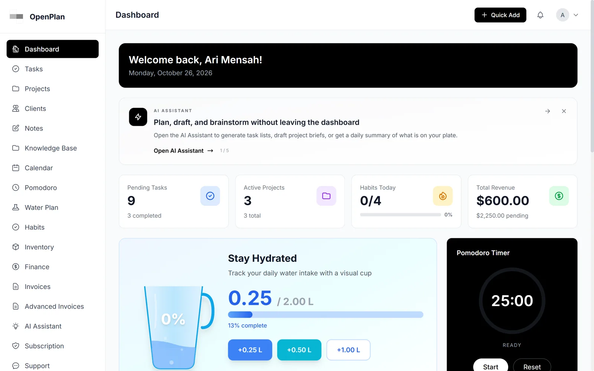

# OpenPlan Work

One encrypted workspace for running a small business: projects and tasks, clients, invoices, finance, inventory, notes and daily routines, with an AI agent that does the admin and an MCP server so your own AI apps can work in it too.

Use it hosted at [openplan.work](https://openplan.work/), or run your own copy for free. PHP 8, no database, no Composer dependencies at runtime.



- **Full guide:** [openplan.work/?page=docs](https://openplan.work/?page=docs)
- **Download:** [main.zip](https://github.com/naijagamerx/openplan.work/archive/refs/heads/main.zip)
- **License:** AGPL-3.0

## What is in it

- **Projects and tasks:** priorities, start and due dates, estimates, subtasks, repeating tasks, templates, a timer that logs time, kanban and list views, bulk actions, CSV export.
- **Clients:** contact details, linked projects, invoiced and paid totals.
- **Invoices:** line items, tax and currency (USD, EUR, GBP, ZAR), PDF download. **Advanced invoices** add a company header, bank details, contract dates, custom fields and two layouts.
- **Finance:** income and expenses; paid invoices count as revenue; six-month chart.
- **Inventory:** SKUs, cost and selling prices, stock in and out with history, reorder points.
- **Notes:** checklists, tags, pins, and Notes AI (improve, summarise, rewrite, turn into tasks).
- **Knowledge Base:** folders of Markdown and XML files that the AI can read.
- **Calendar and meetings, habits with streaks, a Pomodoro timer with your own music, and a water plan.**
- **Mobile web app** at `/mobile/`, with a wide layout for foldables and tablets, and an Android app (a WebView of openplan.work).
- **Plans and payments** for operators who want to sell AI access: plans with model lists and request limits, a free trial, PayFast card subscriptions (ZAR) and manual bank or crypto payments.

## AI

- Bring your own key for **Groq, OpenRouter or Google Gemini**, or point it at your own **Ollama** server. Operators can also share their keys through plans.
- **Agent mode** carries out actions on tasks, projects, clients, invoices, transactions, notes, habits, stock, the Pomodoro timer and water. It runs on OpenRouter and Gemini models; Groq models are used for chat and writing only.
- Choose a Knowledge Base folder to give the assistant context. Smart mode routes long requests to the stronger provider.
- Whatever you send to the AI goes to that provider.

## MCP server (86 tools)

AI apps that support the Model Context Protocol can read and update a workspace.

1. In the app, open **Settings → Developer Tools → MCP Config** and generate a token. It is shown once and opens the whole workspace, so keep it private.
2. Remote (HTTP), for example in `.mcp.json` for Claude Code or `.cursor/mcp.json` for Cursor:

   ```json
   {
     "mcpServers": {
       "openplan": {
         "type": "http",
         "url": "https://your-site/api/mcp-server.php",
         "headers": { "X-MCP-Api-Token": "YOUR_TOKEN" }
       }
     }
   }
   ```

3. Local (stdio), for apps such as Claude Desktop: run `npm install` in `mcp-server/` (Node.js 18+), then:

   ```json
   {
     "mcpServers": {
       "openplan": {
         "command": "node",
         "args": ["/full/path/to/mcp-server/index.js"],
         "env": { "API_URL": "https://your-site/api", "MCP_API_TOKEN": "YOUR_TOKEN" }
       }
     }
   }
   ```

## Security, stated plainly

- Each account's data is stored in its own files, encrypted with **AES-256-GCM** (a fresh IV on every save). The key is a SHA-256 hash of the user's master password, so a long, unique master password matters. A stronger key derivation is planned.
- Sign-in is two steps: email and password (bcrypt), then the master password (rate-limited). The master password is not stored with the data and cannot be reset.
- The account list (names, emails, password hashes, roles) is not encrypted. While a user is signed in, their master password is held in the server-side PHP session (a session file on the server with the default handler) until they sign out or it expires. MCP, device and Alexa tokens carry a wrapped copy of the key.
- This is **encryption at rest, not end-to-end encryption**: whoever runs the server is trusted while users are signed in.
- CSRF tokens on every change, HttpOnly cookies, and `.htaccess` rules that block `data/` and `.env`.

Found a security problem? Please open a private security advisory on GitHub rather than a public issue.

## Self-hosting

**Requirements:** PHP 8.0+ with `json`, `mbstring`, `openssl`, `curl`, `zip` and `calendar`. Apache with `.htaccess` allowed; on Nginx, deny web access to `/data/` and `/.env` yourself before adding any data. PHP needs write access to the app folder (it creates `data/`).

1. Download the ZIP or clone this repository, and upload it to your web folder.
2. Open the site. It goes to the setup page: create the admin account and choose **Single User** (sign-ups closed) or **Multi User**.
3. Optional: copy `.env.example` to `.env` for email (`MAIL_DRIVER`, `SMTP_*`), email verification, branding, Alexa, plans and payments. Every key is explained in the file.

**Run locally:** `php start_server.php` (or `start_server.bat` on Windows), then open http://localhost:8000.

**Daily job** (plan and trial emails, expiry, log clean-up, AI daily brief): set `LAZYMAN_CRON_KEY` and `LAZYMAN_MASTER_PASSWORD` in `.env`, then call once a day:

```
curl -s "https://your-site/api/cron.php?job=run_daily&cron_key=YOUR_CRON_KEY"
```

or run `php api/cron.php job=run_daily` from the app folder.

**Updating:** back up `data/` and `.env`, then upload the new files over the old ones. The download contains neither, so your data is kept.

## Development

`composer.json` holds dev tooling only (PHPUnit, PHPStan, php-cs-fixer). Run `php -l` on any PHP file you change. Product, technical and design specs are in [`docs/PRD.md`](docs/PRD.md), [`docs/TRD.md`](docs/TRD.md) and [`docs/DESIGN.md`](docs/DESIGN.md).

## License

OpenPlan is free software under the [GNU Affero General Public License v3.0](LICENSE) (AGPL-3.0).

- You may use, self-host, study, modify and share it, including for commercial work.
- If you change it and let other people use your changed version over a network (for example as a hosted service), you must offer those users the source code of your changed version under the same license.
- It comes with no warranty. See [LICENSE](LICENSE) for the full terms.
